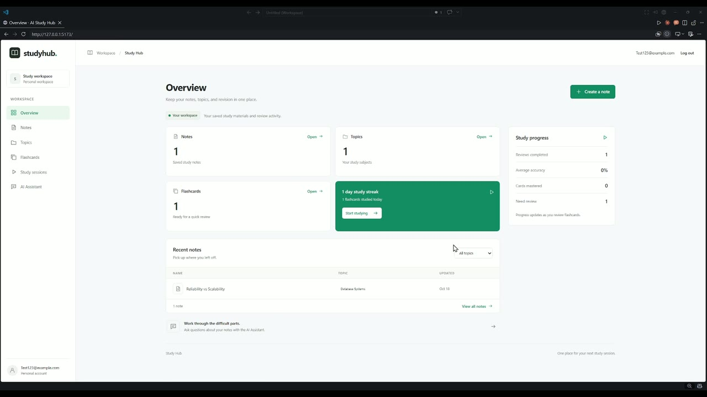
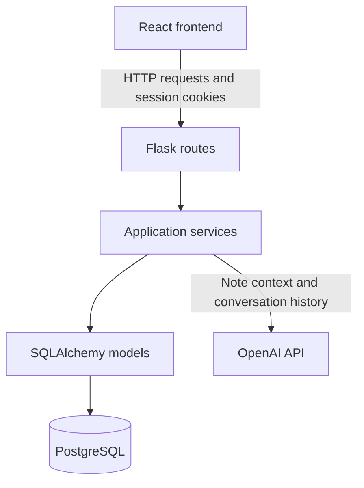

# AI Study Hub

**[▶ Watch the project demo · 2 min 35 sec](https://github.com/user-attachments/assets/f7800144-08f3-44a6-a624-629285370982)**

[](https://github.com/user-attachments/assets/f7800144-08f3-44a6-a624-629285370982)

A study workspace for organizing course notes, practicing recall with flashcards, and working through difficult concepts with an AI tutor.

## About

AI Study Hub is a full-stack Computer Science portfolio project built with React and Flask. It brings study material and revision tools into one workspace: organize notes by topic, create flashcards, review them in study sessions, and ask questions using saved notes as AI context.

The React frontend communicates with the existing Flask backend through HTTP endpoints. Flask handles authentication, ownership checks, database operations, and OpenAI requests. Notes and AI conversations are stored so students can return to their work later.

## Features

- **Accounts:** Register, sign in, and sign out using Flask session authentication and CSRF-protected requests.
- **Dashboard:** View saved material counts, recent notes, and recorded flashcard study progress.
- **Notes:** Create, read, edit, delete, and search notes by title or topic.
- **Topics:** Organize notes into subjects and manage topic names, descriptions, and colors.
- **Flashcards:** Create and edit question-and-answer cards, search the library, and filter cards by note, topic, or difficulty.
- **Study sessions:** Reveal answers, mark cards as correct or needing practice, and view a session summary.
- **AI Assistant:** Open a note's saved conversation, preview its content, ask follow-up questions, and optionally include related topic notes. Starter prompts help with summaries, explanations, and practice questions.
- **Responsive interface:** Shared navigation, keyboard shortcuts in the assistant, and visible loading, empty, and error states.

The backend also contains quiz, study-plan, and PDF-extraction services. These are separate from the current React workflows; the demo and feature list above describe the connected frontend.

## Technology

| Layer | Tools |
| --- | --- |
| Frontend | React, React Router, Vite, CSS |
| Backend | Python, Flask, Flask-SQLAlchemy, Flask-Migrate, Flask-WTF |
| Database | PostgreSQL via Psycopg for Docker development, SQLite for tests |
| AI | OpenAI Python SDK, called from Flask |
| Local development | Docker Compose |
| Tests | Pytest and Node.js test runner |

## Architecture



- Users own topics, notes, flashcards, and study records. The API checks ownership before accessing private material.
- Notes can belong to a topic, and flashcards are linked to notes.
- Conversations group saved user and assistant messages for a note.
- React calls Flask to ask AI questions. The OpenAI key stays on the server.
- A shared frontend API client sends session cookies and obtains a fresh CSRF token before mutations.

## Run locally with Docker Compose

You need Git and a running Docker Desktop installation, or Docker Engine with the Compose plugin. Docker installs the app's Python and Node dependencies during the build.

```bash
git clone https://github.com/gzxfy/AI-Study-Hub.git
cd AI-Study-Hub
docker compose -f docker/compose.yaml up -d --build
```

Once the command finishes, open your web browser and go to [http://localhost:5173/app](http://localhost:5173/app). Register an account, sign in, and create a topic and note. The first build may take a few minutes. Docker runs the app in the background, so the terminal prompt returns and you can open the browser yourself.

Compose starts PostgreSQL and waits for its health check. The backend then applies Alembic migrations before starting Flask, and Vite forwards browser API requests to Flask.

Run these commands from the repository root:

| Command | What it does |
| --- | --- |
| `docker compose -f docker/compose.yaml ps -a` | Shows the status of all three services, including stopped containers. |
| `docker compose -f docker/compose.yaml logs db backend frontend` | Shows logs for PostgreSQL, Flask, and Vite. |
| `docker compose -f docker/compose.yaml stop frontend backend db` | Stops AI Study Hub's services. |
| `docker compose -f docker/compose.yaml up -d --build` | Starts the app again and rebuilds images as needed after code or dependency changes. |

PostgreSQL stores notes and accounts in a named Docker volume that survives container replacement. This setup is for local development.

### Optional configuration

The app's study features work without an API key. To enable real AI replies, create a `.env` file at the repository root and set these values as needed:

```dotenv
OPENAI_API_KEY=your-real-openai-api-key
SECRET_KEY=replace-with-a-long-random-secret
```

A stable `SECRET_KEY` keeps login sessions valid across backend restarts. Keep the `.env` file private. After changing it, rerun the Compose startup command to apply the settings.

### Troubleshooting

| Symptom | What to check |
| --- | --- |
| Docker cannot connect to its engine | Start Docker Desktop or your Docker Engine service and retry. |
| Compose cannot find the configuration | Run the command from the repository root so `docker/compose.yaml` resolves correctly. |
| Port 5173 or 5433 is already in use | Stop the local server or container using that port and rerun the startup command. |
| The page opens but API requests fail | Check `ps -a` and the backend logs. If a migration failed, the logs show why Flask did not start. |
| The AI assistant cannot reply | Check that the backend received a valid `OPENAI_API_KEY` and that your account has API access. |

## Tests

Run the backend suite from the repository root with the Python virtual environment active:

```bash
python -m pytest
```

Latest verified backend result, including the four migration regression tests:

```text
171 passed, 1 skipped, 731 warnings in 19.94s
```

This result does not mean the application has zero warnings or that every deployment workflow has been tested. Review the skipped test and warnings when preparing a release.

With Node.js installed, run the frontend tests and production build from the repository root:

```bash
npm --prefix frontend ci
npm --prefix frontend test
npm --prefix frontend run build
```

Frontend assistant tests cover conversation response validation, request IDs for retries, message formatting, session credentials, CSRF, cancellation, and request failures. Backend migration tests build the schema through Alembic instead of `db.create_all()`, verify model columns, exercise the signed-in study flow, and check that upgrades preserve existing data. Local-launcher tests verify that placeholder MySQL settings are overridden, data/session keys survive restarts, and migration failures stop startup. Pytest is configured to discover `test/`, so a nested test checkout is not accidentally collected as a second test suite.

## Project layout

```text
backend/
  models/       SQLAlchemy entities and relationships
  routes/       Flask HTTP endpoints
  services/     Application and AI logic
  utils/        Shared validation
frontend/
  src/
    api/        Requests to Flask
    assistant/  Conversation UI and response formatting
    auth/       Session state and protected routes
    components/ Shared UI components
    hooks/      Data loading helpers
    layouts/    Shared page layouts
    pages/      Application screens
    styles/     CSS
  tests/        Frontend tests
alembic/        Currently configured migration directory
docker/         Compose configuration and app Dockerfiles
docs/           Demo video and preview image
test/           Backend tests
templates/      Legacy Jinja templates
static/         Legacy Flask assets
run.py          Flask entry point
run_local.py    Migrate and start an isolated local SQLite workspace
```

## Next steps
- Update the backend to Django
- Verify migration upgrades against the deployment database and complete production hosting setup.
- Expand browser testing across the main workflows and mobile layouts.
- Improve AI availability errors, usage limits, and handling of concurrent requests.
- Continue backend cleanup after verifying the connected frontend workflows.
- Switch the authenication system instead of using session based cookies
- implement more test to test postgreSQL
- API security


